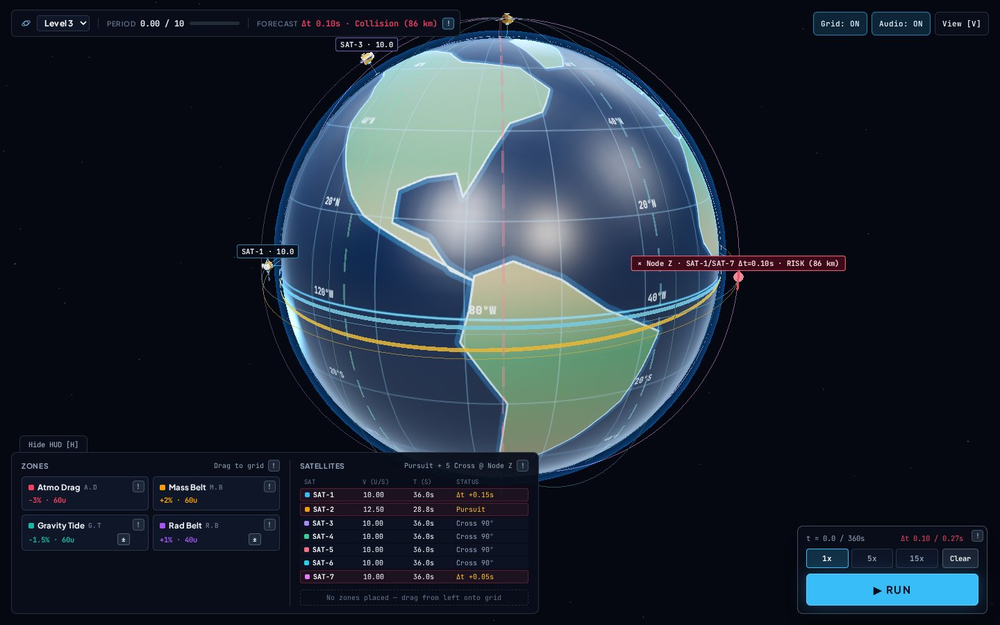

# Orbital Watch 🛰️

**A deterministic 3D orbital collision-avoidance puzzle — a GeoGame built on orbital mechanics.**

▶ **Play:** https://YOUR-USERNAME.github.io/orbital-watch/



## How to play

Satellites share orbital nodes and are on a collision course. Drag **perturbation zones** (Atmospheric Drag, Mass Belt, Gravity Tide, Radiation Belt) onto Earth's 20° grid to speed up or slow down satellites as they pass through. Each zone changes transit time by

```
t = L / v_modified
```

Spread the satellites apart at the crossing node and press **RUN** — clear **10 orbital periods** without a conjunction to win. Three levels.

**Controls:** drag to orbit · scroll to zoom · drag a zone card onto the grid · `±` flips a zone's sign · `H` hide HUD · `V` view

## Tech

- Single-file app: `index.html` (Three.js r170 from jsDelivr CDN), no build step
- Deterministic engine mirrored in TypeScript under `src/sim/` with unit tests (`node:test`)

## Run locally

```bash
npx serve .          # then open http://localhost:3000
npm install && npm test   # engine tests
```

## Deploy

GitHub Pages → *Settings → Pages → Deploy from a branch → `main` / root*.
